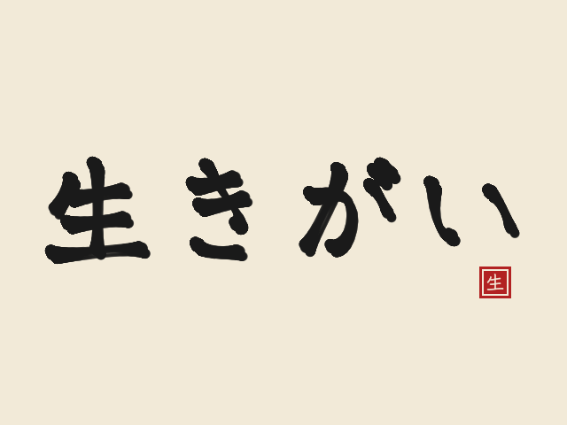

# _Brush Ink_


## **Screenshot**



## **Algorithm**

A brush writes the word _ikigai_ (生きがい, "a reason for being") by itself, stroke by stroke, in the correct stroke order.
The brush is the one of BUN's [OpenProcessing sketch](https://openprocessing.org/sketch/755877),
explained in [this Gorilla Sun article](https://gorillasun.de/blog/Simulating-brush-strokes-with-Hooke's-Law-in-P5JS-and-Processing):
it is not drawn at the pen position, it is attached to the pen by a spring.

The strokes come from [KanjiVG](https://github.com/KanjiVG/kanjivg): each one is the centre line of the brush,
an SVG path made of cubic Bézier curves on a 109×109 grid. At startup, each path is turned into points
evenly spaced along the curve (one pixel apart on the screen), and the 4 characters are placed on one row.

The pen (the "mouse" of the original sketch) walks each stroke slowly at its start and its end, and faster in its middle:

```javascript
index = (n - 1) * t * t * (3 - 2 * t); // t goes from 0 to 1 during the stroke
```

On every frame, the brush follows the pen with Hooke's law (the force of a spring is proportional to its stretch),
and friction slows it down. The faster the brush, the thinner the stroke, like a real brush pressed less when moving fast:

```javascript
vx = (vx + (pen_x - x) * SPRING) * FRICTION; // SPRING = 0.4, FRICTION = 0.45
vy = (vy + (pen_y - y) * SPRING) * FRICTION;
v = (v + (sqrt(vx * vx + vy * vy) - v)) * 0.6; // smoothed speed
r = BRUSH_SIZE - v * THIN;
x += vx;
y += vy;
```

When the pen stops at the end of a stroke, the spring overshoots and comes back: this gives the small "flick" of the stroke ends.

The move of a frame is split into 20 sub-steps. For each of them, three soft discs are stamped on the paper with a low opacity:
the main one and two smaller ones moved aside, which leave the thin lines of the bristles where the brush goes fast.
The screen is never cleared while writing, so the ink accumulates.

Once the word is written, a red seal is stamped, the page stays on screen for 3 seconds, fades back to blank paper, and the brush starts again.

## **License**

All the code are under the **Apache License 2.0**.  
A copy of the license is available [here](https://choosealicense.com/licenses/apache-2.0/).

Stroke data: KanjiVG (https://github.com/KanjiVG/kanjivg) © Ulrich Apel, CC BY-SA 3.0.

The brush algorithm is BUN's ([@BUN_information](https://twitter.com/BUN_information)).
