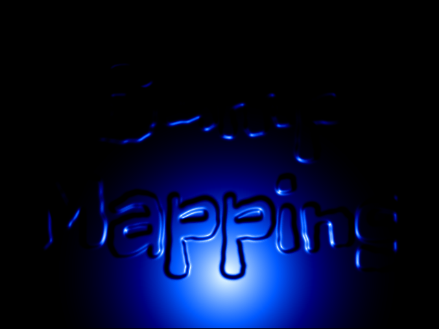

# _Bump Mapping_


## **Screenshot**



## **Algorithm**

The effect is the classic 2D bump mapping: a still image is used as a height map (white is high, black is low)
and a light moves over it. Every pixel looks like it is lit according to the slope of the relief.

The height map is a pre-rendered image (`assets/heightmap.png`). It is generated by a script so the text can be changed easily:

```bash
python3 scripts/heightmap.py "Bump\nMapping"
```

At startup, the height map is smoothed (box blur) so the letters get rounded edges, then the slopes are computed once:

```javascript
nx[x][y] = height[x + 1][y] - height[x - 1][y];
ny[x][y] = height[x][y + 1] - height[x][y - 1];
```

A light spot (environment map) is also computed once: its intensity decreases with the distance to its centre.

For each frame and each pixel, the light spot is read at the distance between the pixel and the light, moved by the slope.
A surface facing the light reads closer to the centre of the spot, so it is brighter:

```javascript
u = x - light_x + center - nx[x][y];
v = y - light_y + center - ny[x][y];
pixel = palette[spot[u][v]];
```

The light follows a slow Lissajous curve across the screen and a blue palette gives the final colour.

## **License**

All the code are under the **Apache License 2.0**.  
A copy of the license is available [here](https://choosealicense.com/licenses/apache-2.0/).

The [Freckle Face](https://fonts.google.com/specimen/Freckle+Face) font used for the height map is under the SIL Open Font License.
