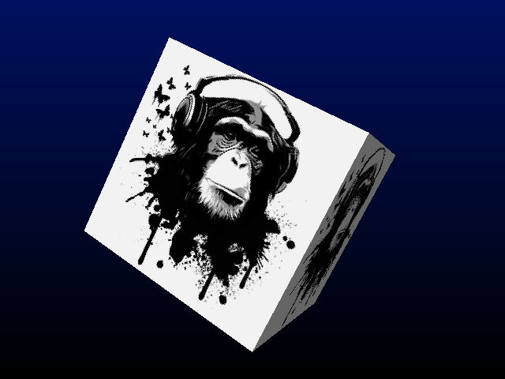

# _Texture Cube_


## **Screenshot**



## **Algorithm**

The effect is the classic rotating cube: each of its 6 faces is mapped with the same picture,
drawn with a perspective-correct texture mapper.

The cube is made of 8 corners and 6 square faces. For each frame, the corners are rotated around the X, Y and Z axes,
each axis with a different speed (1, 2 and 3 degrees per frame) so the movement never looks repetitive.
They are then projected on the screen:

```javascript
k = ZOOM / (z + DEPTH);
screen_x = center_x + x * k;
screen_y = center_y + y * k;
```

The cube is convex: a face is either fully visible or fully hidden, and two visible faces never overlap.
So no sorting is needed, a face is simply skipped when its projected corners turn the wrong way (back-face culling):

```javascript
visible = (b.x - a.x) * (c.y - a.y) - (b.y - a.y) * (c.x - a.x) > 0;
```

Each visible face is drawn by a reusable polygon filler (`library/gfx/texture.ts`). After the projection, `u` and `v`
are not linear on the screen anymore, but `u/z`, `v/z` and `1/z` are. They are interpolated along the edges and then
along each span, and the real texture coordinates are found back with a division:

```javascript
u = u / z / (1 / z);
v = v / z / (1 / z);
```

A division per pixel is expensive, so the exact `u, v` are only computed every 16 pixels and linearly interpolated
in between: the error is invisible and the mapping stays fast.

Each face also gets a flat shading: its brightness depends on the angle between its normal and a fixed light,
with an ambient part so the faces in the shadow never become black:

```javascript
shade = min(1, AMBIENT + DIFFUSE * max(0, normal.light));
```

The background is a vertical gradient from dark blue to black.

The texture (`assets/texture.png`, 256x256) is generated by a script that centres the picture on a white square:

```bash
python3 scripts/texture.py
```

It reads `tmp/chimps-3.png` by default; another image can be given as argument.

## **License**

All the code are under the **Apache License 2.0**.  
A copy of the license is available [here](https://choosealicense.com/licenses/apache-2.0/).

Chimp artwork: free to use, artist unknown.
