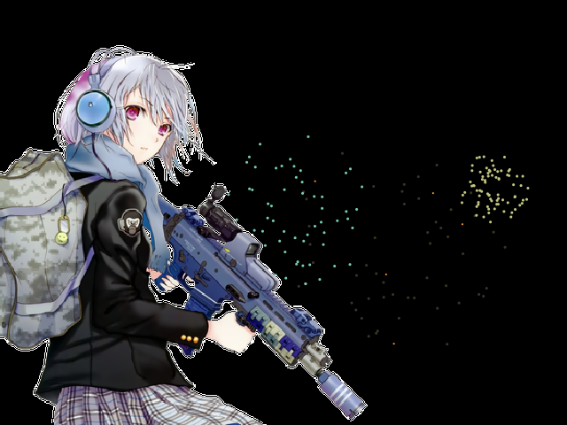

# _Fireworks_

## **Screenshot**

## **Layout**

The screen is split in two halves on a black background.  
The left half shows a sprite pinned to the bottom-left corner. It is scaled (aspect ratio kept) so its height is 90% of the screen height, whether that means scaling it down or up. If the sprite fails to load, nothing is drawn on the left.

## **Algorithm**

A new rocket is launched from the bottom of the right half every 12 frames (25 FPS, so about five rockets are in flight at once). Its x position is random within that half.

- **Rocket:** it starts with an upward speed of -9 and is pulled down by a gravity of 0.15 per frame. When its vertical speed becomes non-negative, it has reached its apex and explodes.
- **Burst:** the explosion creates 40 to 80 sparks at the apex. Each spark gets a random direction and a speed between 1 and 4, and a random bright colour (each RGB channel between 128 and 255).
- **Sparks:** they follow the same gravity and fade out linearly over 38 frames (about 1.5 seconds). They are removed when their life reaches zero.

Particles are stored in a fixed pool of 512 typed arrays. Dead particles are removed by swapping them with the last live one. The random generator is seeded, so every run is identical.

Each frame, the background is cleared to black, then the rockets and sparks are drawn as discs (sparks fade with their remaining life), and finally the sprite is blended on top. Particles therefore show through the transparent parts of the sprite.

## **License**

All the code are under the **Apache License 2.0**.  
A copy of the license is available [here](https://choosealicense.com/licenses/apache-2.0/).
