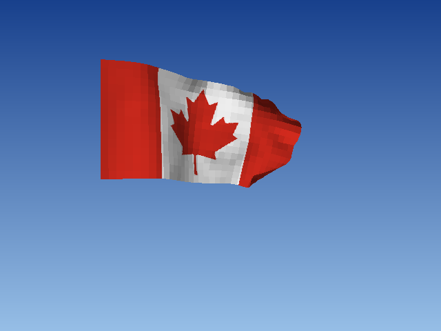

# _Flag_


## **Screenshot**



## **Algorithm**

The flag of Canada is a piece of cloth simulated in 3D. It is shown flat and still for 3 seconds, then its free side
falls (the left side is attached to an invisible pole) and it hangs, until a gusty wind coming from the left lifts it
and makes it wave. After about 30 seconds it fades out and everything starts again.

The cloth is a grid of 32 x 16 points. Each point only remembers its position and its previous position: its speed is
the difference of the two (Verlet integration). On every step, the free points move with their speed (slightly damped)
and the forces:

```javascript
next = pos + (pos - prev) * DAMPING + force * dt * dt;
prev = pos;
pos = next;
```

The points are then held together by links. A link does not pull like a spring: it simply moves its two ends back to
its rest length (half each, or all of it on the free end when the other one is on the pole). Repeated a few times,
this keeps the fabric from stretching, and the simulation can never explode:

```javascript
d = pb - pa;
corr = (length(d) - rest) / length(d) * stiffness;
pa += d * corr / 2;
pb -= d * corr / 2;
```

There are three kinds of links:

- between direct neighbours (right and below): the fabric itself, it does not stretch;
- along the diagonals: the cells keep their shape (no shearing);
- between points two apart: the cloth resists sharp folds. These are soft, so the cloth can still fold.

The whole weight of the flag hangs on the top of the pole, which a few passes cannot hold: every point is also tied
to the top, the bottom and its own point of the pole, and is never allowed to be further from them than at rest
("long range attachments"). Each frame is split in 16 small steps to keep the fabric tight.

The wind pushes each cell along its normal, proportionally to how much the cell faces the wind. A cell facing the wind is
pushed, a cell edge-on is not: this is what lifts the flag and makes it ripple. On top of it, a small drag along the wind
pulls the hanging flag out, and a turbulence travelling from the pole to the tip makes the waves. The strength of the wind
changes with a 1D noise (the gusts).

For the rendering, each cell of the grid is a quad drawn with the perspective-correct textured polygon filler of the library
(`files/library/gfx/texture.ts`), from the farthest cell to the nearest (painter's algorithm). A cell folded on itself on the
screen is drawn as two triangles. Each cell is shaded from the angle between its normal and the light; both sides of the
cloth are lit:

```javascript
shade = AMBIENT + DIFFUSE * abs(normal.light);
```

The texture (`assets/flag.png`, 256x256) is generated from the official geometry of the flag (2:1, red bands of a quarter
of the width, 11-point maple leaf). It is squeezed in a square, and gets its shape back on the 2:1 cloth:

```bash
python3 scripts/flag.py
```

## **License**

All the code are under the **Apache License 2.0**.  
A copy of the license is available [here](https://choosealicense.com/licenses/apache-2.0/).

Maple leaf outline: Wikimedia Commons "Flag of Canada (Pantone).svg" (public domain).
