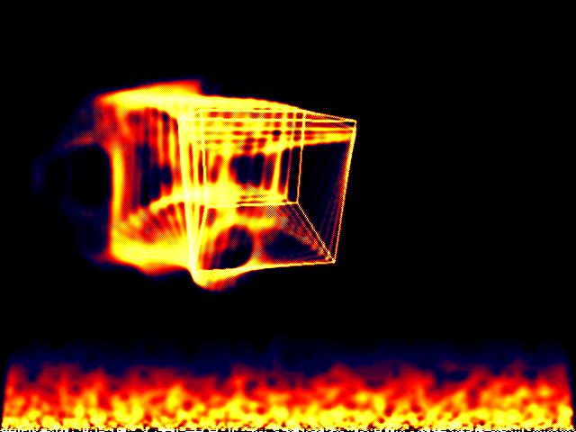

# _FireCube & Flames_

## **Screenshot**

## **Palette**

The palette is composed of 256 colors, built in 8 blocks of 32 colors:

- 32 colors from black to blue (`0, 0, 2i`)
- 32 colors from blue to red (`8i, 0, 64 - 2i`)
- 32 colors from red to yellow (`255, 8i, 0`)
- 160 colors from yellow to white (the blue channel rises from 0 to 255 in 5 steps of 32 colors)

It fades to black at index 0 at the bottom and goes to white at index 255 at the maximum.

## **Algorithm**

The flame buffer is a byte array the size of the screen, holding palette indexes.  
On each frame, the buffer is traversed from top to bottom, and each pixel is replaced by the average of its four neighbours (top, left, right and bottom). The sum is reduced by 3 to attenuate the fire, clamped at 0, then divided by 4 with a right shift. The result is written to the pixel above, in place, which makes the fire move up and fade out.

The bottom two rows are then refilled each frame: every pair of pixels is set randomly to white (about 45% of the time) or to black. This fuel keeps the fire going.

Because the averaging uses a division by 4, the number of averaged pixels is a power of two.

## **FireCube**

To draw the 3D cube in fire, the cube's edges are rendered directly into the flame buffer as white pixels.  
The cube is a 200-unit cube rotated around all axes by 2 degrees per frame, projected onto the screen, and its center bounces between 20% and 80% of the width and between 20% and 70% of the height.

To leave a flame trail, the cube is only redrawn every 3 frames, so the fire has time to burn the previous outline.

The edges are traced with the [Bresenham](https://en.wikipedia.org/wiki/Bresenham%27s_line_algorithm)
algorithm, and pixels too close to the left or right border (within 2 pixels) are skipped.

## **License**

All the code are under the **Apache License 2.0**.  
A copy of the license is available [here](https://choosealicense.com/licenses/apache-2.0/).
