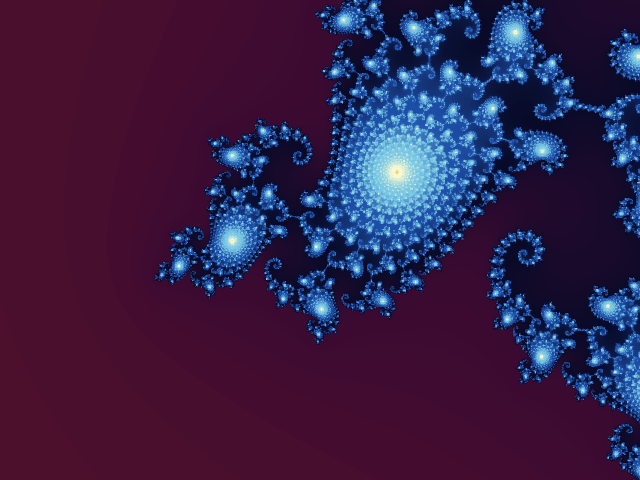

# _Fractal Infinite Zoom_


## **Screenshot**



## **Algorithm**

### The loop

The Mandelbrot set is not exactly self-similar, but it holds tiny copies of itself: the
**mini-Mandelbrots**. The zoom dives into one of them, hidden in the Seahorse Valley (period 35,
about 7 billion times smaller than the full set), so the last image looks like the first one. A short
crossfade hides the remaining differences and the animation starts over.

A mini-Mandelbrot is found from a point near it: its **period** _p_ (ball method on the iteration
derivative), its **nucleus** _n_ (Newton's method on _z<sub>p</sub>(c) = 0_) and its complex **size**
_s_, whose modulus is the scale of the copy and whose argument is its rotation. The map

```typescript
M(w) = n + s * w;
```

sends the full set onto the copy. The zoom follows this similarity: at level _z_ (0 to _N_), the view
is the first view scaled by _|s|<sup>z/N</sup>_ and turned by _arg(s) z/N_ around the fixed point of
_M_. The level _N_ shows exactly _M_(first view), and the copy is upright at the end of the zoom.

### Keyframes

Deep zooms need hundreds of thousands of iterations per pixel, far too slow for real time. A Node
script (`scripts/fractal-keyframes.mts`) renders 34 keyframes offline, each one twice as deep as the
previous one, with 3x3 samples per pixel. A keyframe (1440x1080) is more than twice as wide as the
screen view (640 pixels at the start of a level), so that the next keyframe always covers the whole
screen. They are stored as 8-bit grayscale PNGs holding a
**palette index** (the logarithm of the smooth escape count), 0 for the inside of the set.

Every keyframe is the previous one scaled by 2 and slightly turned around the same pixel (the
image of the fixed point). At level _z = k + f_ the effect draws keyframe _k_ scaled by _2<sup>f</sup>_
and turned by _f_ steps (a small rotozoom walked incrementally on every line), and blends in the
sharper keyframe _k+1_ with weight _f_ over the whole screen, so the change of keyframe is seamless.

### Colours

The escape counts around a mini-Mandelbrot are higher than around the full set, so the last keyframe
has the colours of the first one shifted by a constant offset. The palette is shifted back
progressively during the zoom, so both ends get the same colours.

Regenerate the keyframes with:

```bash
$ node scripts/fractal-keyframes.mts [--size 1440x1080] [--view 640] [--ss 3] [--target 35|39]
```

## **License**

All the code are under the **Apache License 2.0**.  
A copy of the license is available [here](https://choosealicense.com/licenses/apache-2.0/).
