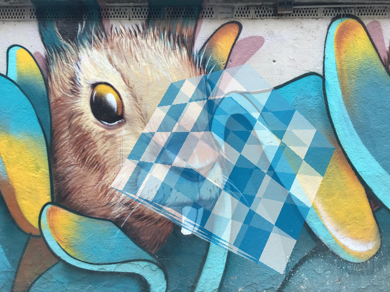

# _A Glass of Picture_


## **Screenshot**



## **Algorithm**

The effect is a Glenz vector: a spinning cube made of checkered glass, in front of a picture.
Where faces overlap, the picture is seen through two layers of glass.

The cube is made of 8 corners and 6 square faces. For each frame, the corners are rotated around the X, Y and Z axes,
each axis with a different speed (1, 2 and 3 degrees per frame). The cube centre also drifts slowly on two sine waves
(in x and y only, so it always stays in front of the camera). The corners are then projected on the screen:

```javascript
k = ZOOM / (z + DEPTH);
screen_x = center_x + x * k;
screen_y = center_y + y * k;
```

Each face is cut into a 4×4 checker of blue and white cells. The grid points are interpolated in 3D between the 4
corners of the face, then projected: a cell of a flat face stays a convex quad on the screen.

Each cell is drawn as glass: its colour is blended over what is already on the screen, per R, G, B channel:

```javascript
dst = dst + (color - dst) * alpha;
```

The cube is convex: seen from the camera, the back faces never overlap each other, and the front faces neither.
So no sorting is needed, but the order matters: the back faces (seen from inside, through the cube) are drawn first,
with a lighter alpha, then the front faces over them. A pixel is covered by two layers of glass at most, and where
a blue cell lies over a white one, the colours mix into the shimmering Glenz look.

A face is a front face when its projected corners turn clockwise:

```javascript
front = (b.x - a.x) * (c.y - a.y) - (b.y - a.y) * (c.x - a.x) > 0;
```

The cells are drawn by a reusable flat polygon filler (`files/library/gfx/polygon.ts`). It uses the same top-left
fill rule as the texture mapper: rows `ceil(ymin) .. ceil(ymax) - 1` and pixels `ceil(xl) .. ceil(xr) - 1`.
Two cells sharing an edge never both draw the same pixel, nor leave a hole between them, so each layer of glass is
blended exactly once: there is no seam between the cells. Along a cube edge, the two faces walk the edge in
opposite directions; their grid points are computed with `(P * (4 - i) + Q * i) / 4`, which gives bitwise the same
values from both sides, so the cube edges have no seam either.

## **License**

All the code are under the **Apache License 2.0**.  
A copy of the license is available [here](https://choosealicense.com/licenses/apache-2.0/).
