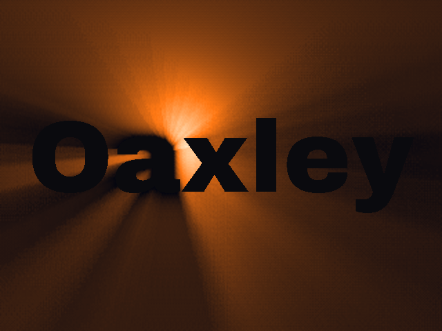

# _Light Rays_


## **Screenshot**



## **Algorithm**

A light swings from left to right and back behind the word _Oaxley_. The letters stay in the shadow,
but wherever the light is not blocked (around the letters, between them, and through their holes: the
inside of the `O`, the bowl of the `a`, the eye of the `e`), its rays stream toward the viewer.

The word is a black and white mask (640×480), drawn once by `scripts/textmask.py` with the
_Archivo Black_ font. At startup, the mask is also reduced to half size (320×240): the rays are
computed at that size, which is 4 times cheaper and looks the same, since light is soft anyway.

The technique is the "volumetric light scattering as a post-process" of GPU Gems 3 (chapter 13),
also known as _god rays_. Each frame:

1. **The light that gets through**: a glow around the light (bright in its centre, fading with the distance),
   plus a dim light everywhere, set to zero on the letters.
2. **Radial blur**: each pixel averages a few samples on the line that goes to the light, the nearest
   counting the most. A pixel whose line crosses a letter is darker: this is the shadow of the letter,
   stretched away from the light. A pixel whose line goes through a gap gets the light: this is a ray.

```javascript
step = ((light - pixel) * DENSITY) / SAMPLES; // DENSITY = 0.9, SAMPLES = 24
p = pixel;
for (k = 0; k < SAMPLES; k++) {
  sum += light_buffer[p] * weight[k]; // weight[k] = DECAY^k, normalised (DECAY = 0.985)
  p += step;
}
```

To hide the steps between the samples, the first sample of each pixel is moved by a small offset
taken from a 4×4 ordered dither pattern.

3. **Composite**: the rays are scaled back to full size (bilinear), turned into colours by a palette
   (near-black blue, then orange, then warm white), and the letters are drawn on top from the full-size mask,
   so their edges stay sharp.

The light follows a sine curve, so it slows down near the screen borders like a pendulum, and drifts a
little up and down so the rays do not always point the same way.

## **License**

All the code are under the **Apache License 2.0**.  
A copy of the license is available [here](https://choosealicense.com/licenses/apache-2.0/).

Font: [Archivo Black](https://fonts.google.com/specimen/Archivo+Black) by Omnibus-Type, SIL Open Font License 1.1.
