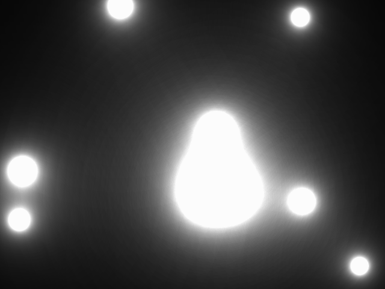

# _Light Balls_


## **Screenshot**



## **Palette**

The palette is a standard 256 colors grayscale palette. To smooth the gradient, each index is passed through a cubic ease function before being turned into a gray level:

```typescript
function ease(x: number): number {
  return x * x * x;
}

function createPalette(): void {
  for (let index = 0; index < 256; index++) {
    const v = Math.floor(255.0 * ease(index / 256.0));
    palette.setColor(index, new Color(COLOR_MODEL.RGBA, v, v, v));
  }
}
```

Since the index is always in [0..255], the input of `ease` stays in [0..1) and the output is always a valid gray level.

## **Algorithm**

The effect uses 10 balls. Each one has a random position, a random velocity (up to 5 pixels per frame on each axis) and a random radius between 60 and 100. On each frame, every ball moves by its velocity, and its velocity is reversed when it crosses the screen edges.

To render, every pixel gets a value that is the sum of the contributions of all the balls. For a ball `k` at distance `d` from the pixel:

```typescript
sum += Math.floor((COEFF * radius_k) / d);
```

with `COEFF = 40`. A ball contributes more the closer the pixel is to its center, so the contributions of nearby balls add up and blend into smooth shapes where they overlap. The sum is clamped to 255 and used directly as an index in the grayscale palette, which gives the pixel its color.

To save work, the squared horizontal distances of each ball are precomputed per column, and the squared vertical distances per row, before the per-pixel loop.

## **License**

All the code are under the **Apache License 2.0**.  
A copy of the license is available [here](https://choosealicense.com/licenses/apache-2.0/).
