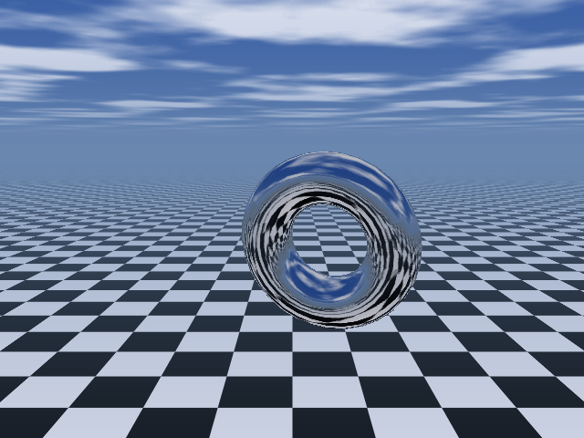

# _Torus Mirror_


## **Screenshot**



## **Algorithm**

A chrome torus spins and drifts above an endless checkered floor. Its lower half reflects the
floor, bent around its curves, and its upper half reflects a sky full of drifting clouds. Nothing is ray-traced: the
mirror is the classic demoscene trick of the _environment map_.

### The floor

The camera looks horizontally along `z`, and the floor is the plane `y = FLOOR_Y` (`y` goes down).
A screen row below the horizon always sees the floor at the same depth, so the floor is drawn row
by row:

```javascript
z = (FLOOR_Y * ZOOM) / (y - HORIZON); // depth of the row
x = ((screen_x - width / 2) * z) / ZOOM; // linear along the row
```

The squares scroll toward the viewer (an offset is added to `z`), and the colour fades into the
horizon haze with the depth (fog, `exp(-z / FOG)`), so the floor melts into the sky at the horizon.

Far away a pixel covers several squares, and taking only one of them gives flickering noise.
Instead, the checker is _box filtered_. Each pixel gets the share of black squares under its
footprint, computed exactly with the integral of the square wave, and the two colours are mixed
by that share.

### The sky

The sky is a gradient, from deep blue overhead down to the haze at the horizon (the floor fog
colour, so floor and sky meet without a line). The clouds lie on a flat ceiling, the plane
`y = CLOUD_Y` above the camera: it is the floor turned upside down, drawn row by row the same way
and scrolling at half the speed of the floor (it is further away).

The cloud texture is made once from a seed: fractal value noise (5 octaves of a smooth random grid,
each twice as fine and half as strong), shaped into puffs by a smooth threshold. Every grid period
divides 256, so it tiles without a seam. Far away a pixel covers many texels, so the texture is kept
at every size (each level is the 2x2 average of the previous one) and the level is picked from the
pixel footprint: far clouds turn into an even veil instead of flickering. They also fade with the
distance, into the gradient.

### The torus

The torus is made of 32 x 16 small quads. The vertices and their normals are rotated around X, Y
and Z (1, 2 and 3 degrees per frame), moved along a path made of sine waves of unrelated
frequencies (mostly left / right, a little up / down), and projected on the screen.

A torus is not convex, so it hides parts of itself. The quads are sorted from back to front
(painter's algorithm), split into 2 triangles, and the triangles facing away are skipped.

### The mirror

For each vertex, the view ray (camera to vertex, normalised) is reflected on the unit normal:

```javascript
r = d - 2 * dot(d, n) * n;
```

The reflected direction is turned into texture coordinates in an _environment map_: a 256x256
picture of what is seen in every direction from the torus. This is a "sphere map" whose axis
points straight down:

```javascript
m = sqrt(2 * (1 + r.y));
u = 128 + (127 * r.x) / m;
v = 128 + (127 * r.z) / m;
```

The centre of the map is the floor right under the torus, the horizon is a circle of radius
`127 / sqrt(2)`, and the outer ring is the cloud ceiling. Each texel is turned back into a
direction: going down it hits the floor (same filtered checker, shorter fog), going up it hits the
ceiling (same clouds and gradient). The per-texel geometry only depends on the distances from the
torus to the floor and to the ceiling, so it is computed once and scaled.

The only bad spot of a sphere map is its rim, where all the texels mean "straight up": the clouds
overhead would smear there. So there are two maps, rebuilt every frame (the floor and the clouds
scroll, the torus moves): one with its pole straight down, one with its pole straight up. A quad
looking up on average is drawn with the sky map, the others with the floor map: the switch
happens at the horizon, where both maps show the same haze, and no quad reaches its own rim. To keep the cost down, only one texel out of four is
computed, the others are averaged from their neighbours (the maps are blurred anyway: the torus
shrinks them a lot).

The triangles are then drawn with the perspective-correct texture mapper used by the cube
(`files/library/gfx/texture.ts`), with the environment map as texture. The chrome reflects 80 % of
the light, so the torus outline still shows where it reflects the sky. The reflection depends on
the view direction and the normal, so it slides over the surface when the torus turns, like a real
mirror.

## **License**

All the code is under the **Apache License 2.0**.  
A copy of the license is available [here](https://choosealicense.com/licenses/apache-2.0/).
