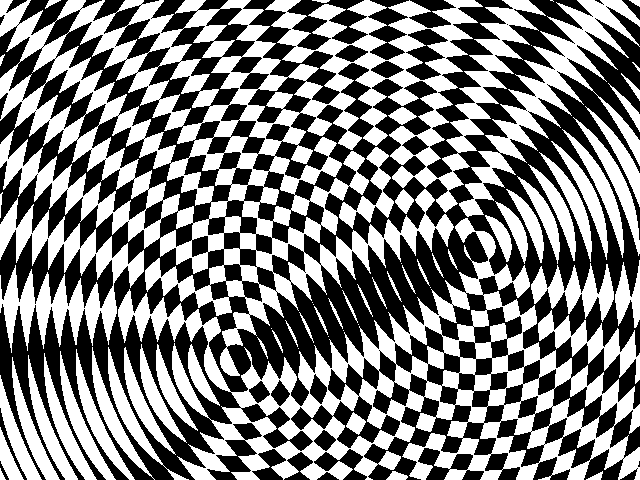

# _Interferencia_


## **Screenshot**



## **Algorithm**

Two circle centers move around the middle of the screen. For each pixel, we compute its distance to each center, then combine the two distances with a XOR and keep a single bit to choose between black and white.

The centers move on elliptical paths around the screen center `(width / 2, height / 2)`, with an amplitude of a quarter of the screen width for X and a quarter of the screen height for Y:

- Center 1: `x = cx + (w/4) * cos(t / 1000)`, `y = cy + (h/4) * sin(t / 2000)`
- Center 2: `x = cx + (w/4) * cos(t / 3000)`, `y = cy + (h/4) * sin(t / 4000)`

where `t` is the elapsed time in milliseconds. The two centers use different periods, so the pattern never repeats exactly.

For each pixel the distances `d1` and `d2` to the two centers are computed with `sqrt(dx² + dy²)`. The squared X distances are precomputed once per column and the squared Y distances once per row, to avoid repeated work.

The distances are then converted to integers and combined:

```typescript
const color = ((d1 ^ d2) >> 4) & 0x01 ? white : black;
```

The `>> 4 & 0x01` test keeps bit 4 of the XOR result. That bit flips every 16 pixels of distance, so each ring of the two circles produces alternating black and white bands. Where the two sets of rings cross at different angles, the bands interfere and form the moire pattern.

The effect runs at 25 FPS.

## **License**

All the code are under the **Apache License 2.0**.  
A copy of the license is available [here](https://choosealicense.com/licenses/apache-2.0/).
