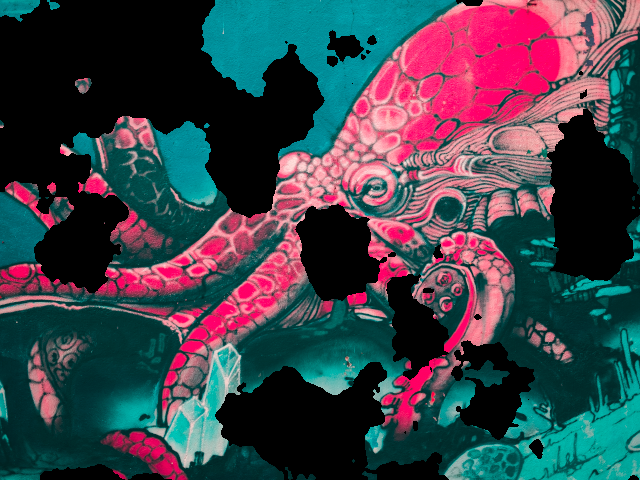

# _A Noisy Apparition_


## **Screenshot**



## **Algorithm**

The image is revealed through a 2D noise map, built once when the effect is created:

- A `Noise2D` generator produces a fractal noise map the size of the screen. Fractal noise sums several octaves of noise at different frequencies, which gives a more detailed texture than a single layer.
- The noise frequency is random on each run (`Math.random() / 10`), so the pattern changes between runs.

The background image (`ts-noise.background.png`) is loaded at start-up. On every frame, each pixel of the screen is compared to its noise value:

```typescript
dst[i] = noise[i] >= threshold ? src[i] : 0;
```

If the noise value is at least the threshold, the pixel shows the image. Otherwise it is set to black.

The threshold moves each frame by `0.005`, starting at `1.0`. Because it starts at the top of the noise range, the first frames are black. When the threshold goes below 0 or above 1, the increment is reversed. So the image fades in and out in a loop, and the spots that appear first are the places where the noise value is highest.

The effect runs at the default frame rate of the animation loop.

## **License**

All the code are under the **Apache License 2.0**.  
A copy of the license is available [here](https://choosealicense.com/licenses/apache-2.0/).
