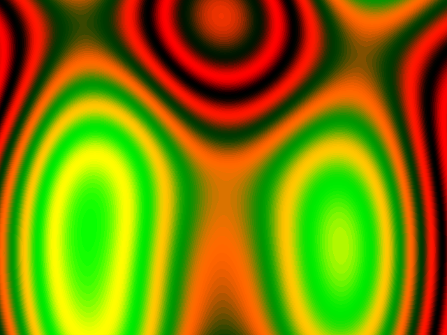

# _Colorful Plasma_


## **Screenshot**



## **Palette**

The palette of 256 colors is built from 3 cosine functions, one per RGB channel.  
Each index `i` is first mapped to a value `t` in the range [-AMPLITUDE, AMPLITUDE] (here [-15, 15]), then each channel is phase-shifted so the colors cycle smoothly.

```typescript
for (let i = 0; i < 256; i++) {
  const t = map(i, 0, 255, -AMPLITUDE, AMPLITUDE);
  const r = map(Math.cos(t + 0.2), -1, 1, 0, 255);
  const g = map(Math.cos(t + 0.4), -1, 1, 0, 255);
  const b = map(Math.cos(t + 0.8), -1, 1, 0, 255);
  palette.setColor(i, new Color(COLOR_MODEL.RGBA, r, g, b));
}
```

## **Algorithm**

A plasma is an intersection of several sine and cosine functions evaluated at each pixel.  
Here, the pixel coordinates are first centered and scaled, then shifted by a time component so the pattern moves:

- `ux` depends on the x coordinate (scaled by the aspect ratio) plus `time * 0.3`.
- `uy` depends on the y coordinate plus `time * 0.3`.
- Two phase terms are computed from `uy` and `ux`, with the time added to the phase offsets:
  - `phaseV = 0.1 + 2.4 * time + cos(uy + sin(0.148 - time))`
  - `phaseH = 0.9 - 0.7 * time + sin(ux + cos(0.628 + time))`
- The distance from the center is `radial = sqrt(ux² + uy²)`.
- The plasma value is the product of a cosine and a sine:
  - `plasma = AMPLITUDE * cos(radial + phaseH) * sin(phaseV + phaseH)`

The value lies in [-AMPLITUDE, AMPLITUDE]. It is mapped to a palette index with `index = 128 + 128 * (plasma / AMPLITUDE)`, clamped to [0, 255], and the corresponding palette color is written to the pixel.

## **License**

All the code are under the **Apache License 2.0**.  
A copy of the license is available [here](https://choosealicense.com/licenses/apache-2.0/).
