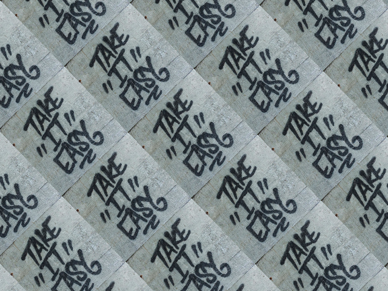

# _Easy Rotozoomer_


## **Screenshot**



## **Texture**

The texture must be exactly 256 pixels wide, and its height can be any value. The code uses the low 8 bits of the x coordinate as the texture column (`xb & 0xff`) and stores the texture row-major with a stride of 256 (`v << 8`), so any other width would sample the wrong pixels. The height is handled by a modulo, so the texture repeats vertically.

## **Algorithm**

For each pixel `(x, y)` of the screen, the code rotates the coordinate by the current angle, scales it, and uses the result as a texture coordinate.

The angle is an index in precomputed cosine and sine tables. It starts at 0 and grows by 1 degree per frame, wrapping at 360. The effect runs at 25 FPS.

The rotation is the standard 2D rotation:

```typescript
xb = Math.floor((x * cos - y * sin) * zoom);
yb = Math.floor((x * sin + y * cos) * zoom);
```

The zoom factor is `zoom = sin + 1`, so it varies between 0 and 2. Since the same `sin` value is used for the rotation and the zoom, the picture grows and shrinks in step with the rotation. It is largest when the coordinates are scaled by 2, and it shrinks towards 0 when `sin` reaches -1. This gives the feeling of the texture moving towards and away from the camera.

The rotation is applied to the screen coordinates directly, which come from the top-left corner. The image therefore turns around the top-left corner of the screen, not around its center.

The texture coordinates are then wrapped:

- `u = xb & 0xff` wraps horizontally, which is why the texture must be 256 pixels wide.
- `v = yb % height` wraps vertically, with a loop to handle negative values.

The texel at `(u, v)` is copied to the screen pixel. The texture repeats on the screen in both directions.

## **License**

All the code are under the **Apache License 2.0**.  
A copy of the license is available [here](https://choosealicense.com/licenses/apache-2.0/).
