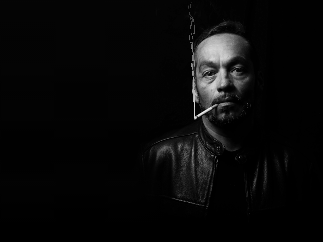

# _Death Smoking_

## **Screenshot**

## **Background**

The picture (`ts-smoke.background.png`) is placed on the right side of the screen, aligned to the top. Its left edge is not pure black, so a visible seam would show against the black area on the left. To hide it:

- The left edge colour is computed for each line by averaging the first 8 columns of the picture, then smoothed vertically over a radius of 24 lines.
- The left area of the screen is filled line by line with this colour, with a 4x4 Bayer dither to avoid banding.
- The first 96 columns of the picture are blended into the fill colour with a smoothstep, also dithered.

The background is built once, when the assets are loaded, and copied to the display on every frame.

## **Algorithm**

The smoke is made of one fixed point and three moving points:

- The fixed point is at the end of the cigarette, at the position of the background picture plus `(137, 235)`.
- Each moving point follows a Lissajous-like path: `x = init + amp * cos(freq1 * π * freq2 * t)` and `y = init + amp * sin(freq1 * π * freq2 * t)`. The three points have different amplitudes, frequencies and starting positions.

The three moving points have delays of -3, -3.14 and -1.5. The fixed point has a delay of 0. The delay shifts the time used to evaluate its position, so the points do not all move in sync.

Three trails connect the fixed point to each of the moving points. A trail is 500 samples. For sample `j`, with `tt = j / 500`:

- The fixed point is evaluated at `t - delay_src * tt`.
- The moving point is evaluated at `t - delay_dst * (1 - tt)`.
- Both positions are linearly interpolated with `tt` to get the sample's screen position.

Because each end is evaluated at a different time, the trail stretches and curls, which gives the smoke look. Each sample is drawn as a single grey pixel, with the brightness going from `0xe0` at the start of the trail to `0x30` at the end.

The time is `t = frames / 200`, so the motion is driven by the frame counter. The frame is copied from the prepared background before the trails are drawn, so the trails are redrawn from scratch on every frame.

## **License**

All the code are under the **Apache License 2.0**.  
A copy of the license is available [here](https://choosealicense.com/licenses/apache-2.0/).
