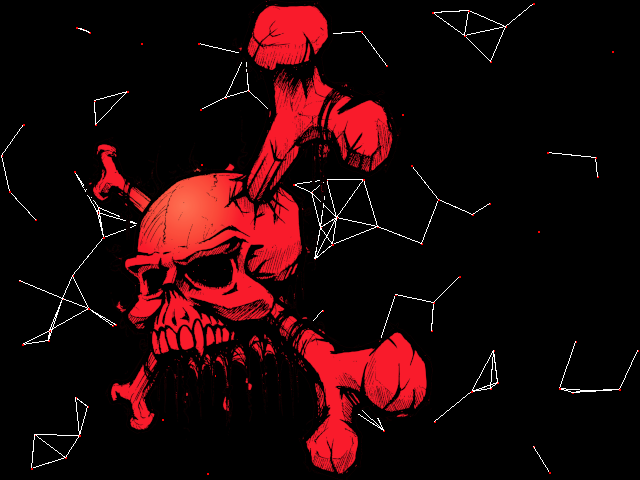

# _A Skull ahead_

## **Screenshot**

## **Algorithm**

The effect uses 100 particles. Each one starts at a random position on the screen, with a random velocity where each axis is between -1 and 1 pixel per frame.

On every frame, each particle moves by its velocity. When it goes past an edge of the screen, its velocity on that axis is reversed, so it bounces back.

To render the frame, the screen is cleared and the particles are drawn as follows:

- For each pair of particles closer than 50 pixels (squared distance below 2500), a white line is drawn between them.
- A particle with no neighbour in range is drawn as a 2x2 red square. The square is only drawn again if no line was drawn to it since the last one, so it is not drawn twice.

On top of that, a sprite (`ts-sprites.sprite.png`) is drawn over the particles. It is placed at the top of the screen and moves horizontally from the right edge to the left edge and back, one pixel per frame. Its transparent parts let the lines and particles show through.

## **License**

All the code are under the **Apache License 2.0**.  
A copy of the license is available [here](https://choosealicense.com/licenses/apache-2.0/).
