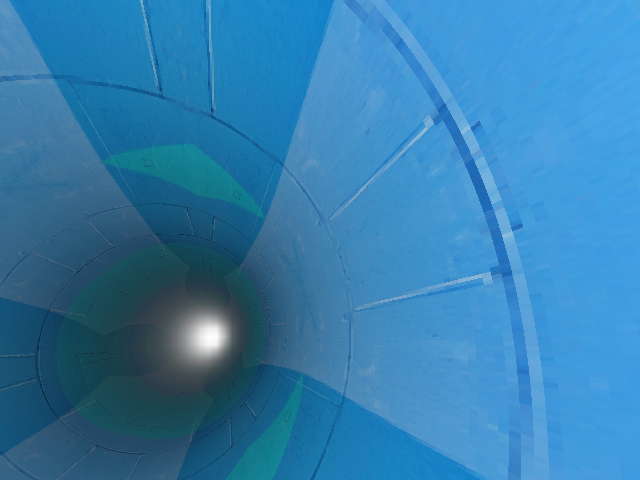

# _Endless Tunnel_

## **Screenshot**

## **Algorithm**

The camera flies inside a tube of radius 1 along the z axis.

- On a coarse grid (one point every 8 pixels), a ray is cast from the camera to the wall of the tube.
  The hit point gives the texture coordinates (angle around the tube, depth) and the light:
  fog that darkens the walls with the depth, and a faint glow at the far end, which stays almost dark.
- Inside each 8x8 block the values are interpolated, so each pixel is only a texture lookup and a shade.
- The camera drifts away from the axis and looks left / right / up / down (with a slow roll):
  the near walls and the end of the tunnel move differently, which gives the depth and the steering.
- The image is reduced to a 128x128 tile and mirrored into a seamless 256x256 texture, so it wraps
  around and along the tube without any seam.

## **License**

All the code are under the **Apache License 2.0**.  
A copy of the license is available [here](https://choosealicense.com/licenses/apache-2.0/).
