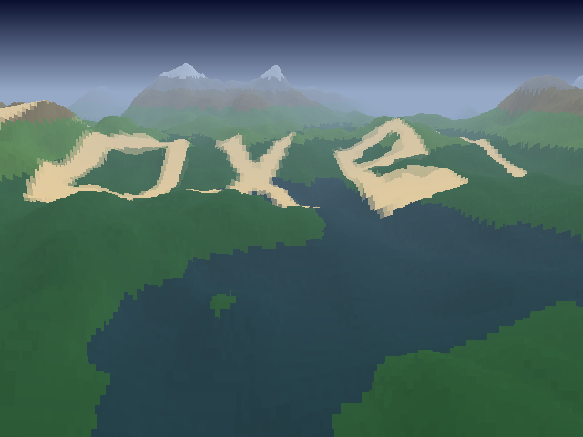

# _Over the hills_


## **Screenshot**



## **Algorithm**

### Terrain

The landscape is two 512x512 maps that wrap on every side (the camera flies forever):

- a **height map**, made of 5 octaves of value noise. Each octave uses a lattice whose size divides
  512, so the map tiles seamlessly.
- a **colour map**, computed once from the height (water, grass, rock, snow) and lit by the slope.

### Voxel renderer

The classic "Comanche" renderer: for each distance _dz_, from near to far, a line of the map is
sampled across the 640 screen columns. The terrain height is projected on the screen:

```typescript
let top = (cameraZ - height) * (HEIGHT_SCALE / dz) + HORIZON;
```

A vertical segment is drawn from _top_ to the highest line already drawn in the column (the
y-buffer), so the near hills hide the far ones. The step between two lines grows with the distance,
and the colour fades into the sky colour (fog).

### Text on the relief

The text is not a 3D object: every frame, the letters are painted **into the colour map**, in a band
a fixed distance in front of the camera, then removed before the next frame. The renderer draws the
map as usual, so the letters bend over the hills and dip into the valleys. The glyphs are stretched
along the flight direction to compensate for the perspective, and the camera altitude follows the
average ground between itself and the text so the band stays in view.

## **License**

All the code are under the **Apache License 2.0**.  
A copy of the license is available [here](https://choosealicense.com/licenses/apache-2.0/).
